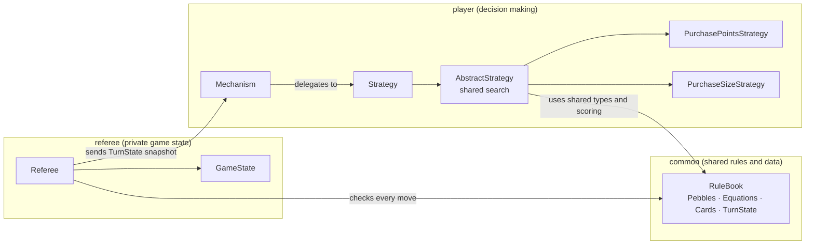
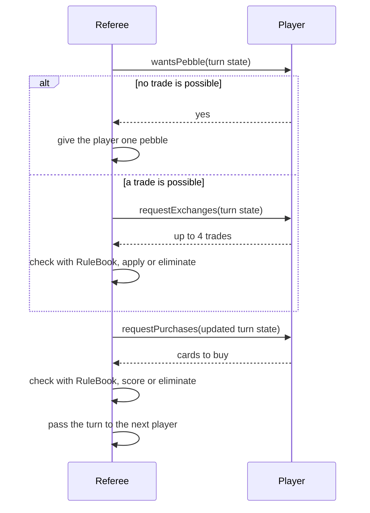

# Bazaar: Game Engine and AI Players in Java

A complete engine for **Bazaar**, a turn-based trading card game, with a rule-enforcing referee and AI players that search for the best move each turn. Players trade colored pebbles with a bank using exchange equations, then spend pebbles to buy cards worth points. The referee runs the game, checks every move against the rules, and removes any player that cheats or crashes.

Built by **Caleb Pucylowski** and **Ethan Pucylowski**.

[](https://github.com/CalebPuc/bazaar/actions/workflows/ci.yml)

---

## Highlights

- **Referee with player isolation:** players only see a read-only snapshot of the game, and any illegal move, exception, or invalid response, from setup through the final win notification, gets that player removed while the game continues
- **Two search-based AI strategies** built on one shared search engine: every legal sequence of up to four exchanges, followed by every affordable set of card purchases, ranked with a deterministic tie-breaking order. Each strategy only defines what "better" means.
- **Immutable game state:** every move produces a new state instead of changing the old one, so a turn can never leave the game half-updated
- **Clean package boundaries:** shared rules live in `common`, so the referee and players check legality the same way without depending on each other
- **237 automated tests**, including 600 full games played from random starting positions and JSON-based tests for each command-line tool, run on every push with GitHub Actions

---

## How the game works

| Element | Rules |
|---|---|
| **Pebbles** | Five colors: red, white, blue, green, yellow. The bank starts with 20 of each. |
| **Equations** | Ten trades per game, such as `2 red ↔ 1 blue + 1 green`. Each side holds 1–4 pebbles, the two sides share no colors, and trades work in either direction. |
| **Cards** | Twenty cards, each showing five pebbles. Some carry a star for bonus points. Four are face up at a time. |
| **A turn** | Either draw one pebble from the bank (allowed only when no trade is possible) or make up to four trades. Then buy any number of face-up cards by paying their pebbles. |
| **Scoring** | Fewer pebbles left after a purchase means more points: 1, 2, 3, or 5 points for a plain card, and 2, 3, 5, or 8 for a starred one. |
| **Game end** | A player reaches 20 points, the cards run out, the bank empties and no one can buy, or no players remain. |

---

## Architecture



| Package | Responsibility |
|---|---|
| `common` | Pebbles, equations, cards, player state, the turn snapshot sent to players, and the `RuleBook` that defines legal moves and scoring |
| `referee` | `GameState` (bank, cards, deck, players) and the `Referee` that runs a game from start to finish |
| `player` | The `Strategy` interface, the shared search in `AbstractStrategy`, two strategies, and the `Mechanism` that answers the referee's requests using a strategy |

### The referee–player protocol

Before play, the referee calls `setup` on each player with the game's equations. After the game, it calls `win` on each remaining player to report the result; a player that fails either call is removed, and a winner that fails `win` loses its win. In between, each turn runs like this:



### Strategies

Both strategies share the search in `AbstractStrategy`: a depth-first exploration of every legal exchange sequence up to four trades long, and for each one, every set of cards the resulting wallet can afford. They differ only in what they maximize:

- **`PurchasePointsStrategy`** picks the turn that earns the most points.
- **`PurchaseSizeStrategy`** picks the turn that buys the most cards.

Each subclass is a single method, so adding a new strategy means writing only its comparison.

Ties are broken the same way every time: fewer trades first, then by a fixed ordering of the cards and trades. This makes every decision reproducible, which is what lets the strategy tests compare against exact expected outputs.

---

## Building and testing

Requires Java 11 or later. The Gradle wrapper downloads everything else.

```sh
./gradlew test       # run all 237 tests
```

On Windows, use `gradlew.bat test`.

### Command-line tools

Five small programs read a game situation as JSON from standard input and print the result. They are used by the JSON tests and are handy for trying out scenarios.

| Tool | Build command | What it does |
|---|---|---|
| `xeq` | `./gradlew xeq` | Lists the equations a player can use given their wallet and the bank |
| `xturn` | `./gradlew xturn` | Extracts the snapshot a player sees from a full game state |
| `xstrategy` | `./gradlew xstrategy` | Shows the trades and purchases a strategy chooses |
| `xrules` | `./gradlew xrules` | Checks whether a sequence of trades is legal and shows the result |
| `xgames` | `./gradlew xgames` | Plays a complete game from a given starting state, with players that can be set to fail at a chosen step, and prints the winners and removed players |

Each build command produces a standalone JAR in `build/libs/`. For example:

```sh
./gradlew xstrategy
java -jar build/libs/xstrategy.jar < src/test/resources/integration/strategy/0-in.json
```

### Tests

| Area | What's covered |
|---|---|
| Data types | Pebble collections, equations, cards, and player state, including invalid inputs |
| Rules | Legal and illegal trades, pebble draws, purchases, and scoring |
| Strategies | Correct choices and tie-breaking for both strategies |
| Referee | Elimination of players that make illegal moves or fail at any step, winner selection, stalemate detection, and game-end conditions |
| Full games | 600 complete games from random starts, confirming the built-in players are never wrongly eliminated |
| Tools | Each command-line tool's output matches the expected JSON, including 10 complete games with misbehaving players |

---

## Project structure

```
src/main/java/common/       shared data types and the rule book
src/main/java/referee/      game state and referee
src/main/java/player/       strategies and player mechanism
src/main/java/x*/           command-line tools
src/test/java/              unit, full-game, and tool tests
src/test/resources/         JSON inputs and expected outputs
docs/observer-design.md     design for a proposed game observer
```

---

## Limitations and possible improvements

- **Brute-force search:** with 10 equations usable in two directions, up to four trades deep, a turn can have over 160,000 exchange sequences to check. In practice a turn takes about 20 ms on average, but the cost grows quickly with more trades. Pruning sequences that can't lead to a better result, or caching repeated wallet states, would scale better.
- **No time limits:** a player that never returns would stall the game. Running each player call on a separate thread with a timeout would let the referee remove it.
- **Some errors aren't caught:** the referee catches exceptions from players, but not serious errors such as running out of memory, which would end the whole game.
- **Fixed game settings:** values such as the four-trade limit, the 20-point goal, and the bank size are constants in the code. Making them configurable would mean passing a settings object through several classes. The scoring table is already defined in one place.
- **Observer not built yet:** [`docs/observer-design.md`](docs/observer-design.md) describes a component for watching games live, which is designed but not implemented.

---

## Authors

**Caleb Pucylowski** — [GitHub](https://github.com/CalebPuc) · [LinkedIn](https://www.linkedin.com/in/caleb-pucylowski)

**Ethan Pucylowski**

Caleb wrote the large majority of the code, including the core data types, rule book, game state, referee, both strategies, the player mechanism, and most of the tests. Ethan built the turn-state tool, the original player–referee protocol diagram, strategy test cases, and bug fixes, and co-authored the design documents.
